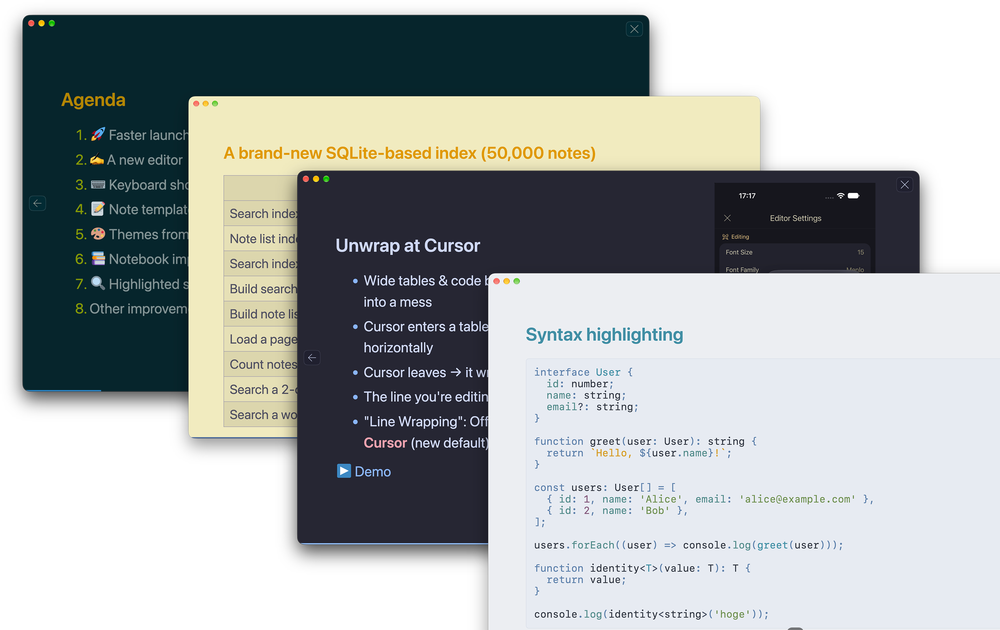
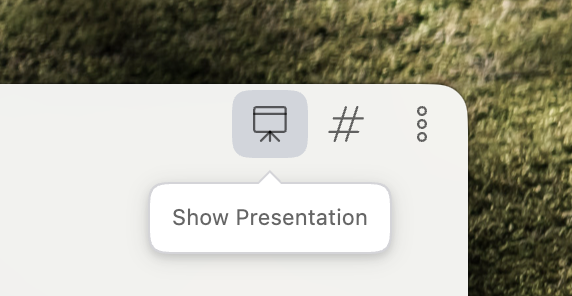

# Presentation plugin for Inkdrop

Present any note as slides, right in the Inkdrop window. Notes written for [Marp](https://marp.app/) render as Marp decks, and regular notes are split into slides automatically. Slides follow your current Inkdrop theme, including light and dark mode.



## Install

Check out [the docs](https://docs.inkdrop.app/manual/extend-inkdrop-with-plugins) on how to install plugins.

### Command-line

```shell
ipm install presentation
```

## Usage

Open a presentation in any of these ways:

- Click the **presentation board** button in the editor header bar.
- Choose **Show Presentation** from the editor header's **…** menu.
- Right-click a note in the note list and choose **Show Presentation**.



The presentation fills the current window.

| Key                                                                           | Action             |
| ----------------------------------------------------------------------------- | ------------------ |
| <kbd>→</kbd> <kbd>↓</kbd> <kbd>Space</kbd> <kbd>PageDown</kbd>                | Next slide         |
| <kbd>←</kbd> <kbd>↑</kbd> <kbd>Shift</kbd>+<kbd>Space</kbd> <kbd>PageUp</kbd> | Previous slide     |
| <kbd>Home</kbd> / <kbd>End</kbd>                                              | First / last slide |
| <kbd>Esc</kbd>                                                                | Close              |

Hover over the slides to show the previous / next buttons, the page number, and the close button in the top-right corner. A progress bar runs along the bottom edge. You can drag the window by the top edge of the presentation.

## Marp decks

A note with `marp: true` in its YAML front matter is presented as a [Marp](https://marpit.marp.app/markdown) deck, exactly as written. Slides are separated by `---`, and all of Marp's directives work, such as `paginate`, `_class`, `style`, and `` backgrounds.

```markdown
---
marp: true
paginate: true
---

# My talk

---

## Agenda

- Intro
- Demo
```

### Themes

Decks without a `theme:` directive use the **`inkdrop`** theme. It is based on Marp's `default` theme, but takes its colors and fonts from your Inkdrop theme. Switching the Inkdrop theme or light/dark mode restyles an open presentation immediately.

To use one of Marp's built-in themes instead, set it explicitly, for example `theme: default`, `theme: gaia` or `theme: uncover`.

### Scrollable slides

Content taller than a slide is clipped, as in any Marp deck. With the `inkdrop` theme, a slide can scroll instead:

```markdown
<!-- _class: scroll -->

## A long slide
```

## Regular notes

A note without `marp: true` is presented in **auto mode**:

- Slides break before each section heading. The plugin uses the shallowest heading level that appears at least twice. For example, `# Title` followed by several `##` sections gives one slide for the title and one per section.
- Every slide scrolls when its content doesn't fit.
- The note's own front matter is left out.
- A horizontal rule (`---`) also starts a new slide.

## Supported content

- **Code blocks** are highlighted by Inkdrop's own highlighter, so colors and languages match the editor, including languages added by plugins.
- **Images attached to the note** (`inkdrop://file:…`) display, both inline and as Marp backgrounds.
- **Task lists** (`- [ ]` / `- [x]`) render with checkboxes. Checked items are struck through.
- **Math** works the same way as in Marp.

## Preferences

| Setting                    | Default | Description                                                                                                                                                  |
| -------------------------- | ------- | ------------------------------------------------------------------------------------------------------------------------------------------------------------ |
| **Transparent background** | Off     | Show the window background behind the slides instead of the editor background. With the translucent window style, this lets the frosted window show through. |

## Development

```shell
pnpm install
pnpm dev        # rebuild on change
pnpm build      # production build into lib/
pnpm typecheck
pnpm lint
pnpm format
ipm link        # symlink into your Inkdrop data directory for local testing
```

Marp is loaded only the first time a presentation is opened, so the plugin adds almost nothing to Inkdrop's startup time.
